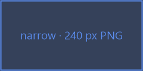
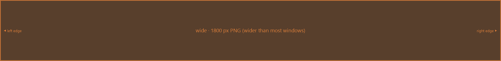
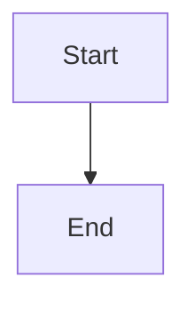
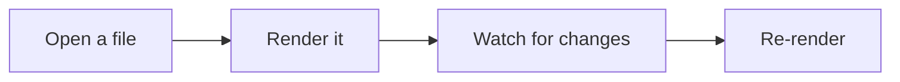
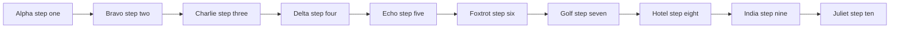
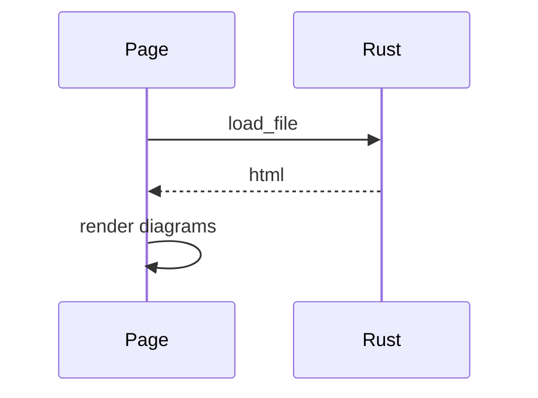

# Widths: narrow, medium and wide samples

One page of every kind of block at three widths, for judging the reading layout: where text
sits, and what wide content does around it. Try it in a wide window and a narrow one.

## Prose

Narrow: a one-line paragraph.

Medium: a paragraph of a few sentences. It runs to about two or three lines in the reading
column, enough to see where the right edge falls and how the lines space out.

Wide: Lorem ipsum dolor sit amet, consectetur adipiscing elit, sed do eiusmod tempor incididunt
ut labore et dolore magna aliqua. Ut enim ad minim veniam, quis nostrud exercitation ullamco
laboris nisi ut aliquip ex ea commodo consequat. Duis aute irure dolor in reprehenderit in
voluptate velit esse cillum dolore eu fugiat nulla pariatur. Excepteur sint occaecat cupidatat
non proident, sunt in culpa qui officia deserunt mollit anim id est laborum. Sed ut perspiciatis
unde omnis iste natus error sit voluptatem accusantium doloremque laudantium, totam rem aperiam,
eaque ipsa quae ab illo inventore veritatis et quasi architecto beatae vitae dicta sunt
explicabo.

### A short heading

### A long heading that keeps going well past the width of the reading column, to see where it wraps

## Lists

- Narrow item
- Another
- Third

1. A medium item: a sentence or so of text, about one line long in the column.
2. A second medium item, with a nested list:
   - nested, short
   - nested, a little longer than the one above it
3. A third medium item.

- A wide item: lorem ipsum dolor sit amet, consectetur adipiscing elit, sed do eiusmod tempor
  incididunt ut labore et dolore magna aliqua. Ut enim ad minim veniam, quis nostrud
  exercitation ullamco laboris nisi ut aliquip ex ea commodo consequat.
- [ ] A task, open
- [x] A task, done

Steps holding wide content:

1. Install it, a step with a short command:

   ```sh
   cargo build --release
   ```

2. Run it, a step with a long command:

   ```sh
   cargo run --manifest-path src-tauri/Cargo.toml -- "F:/a/fairly/long/path/to/some/document.md" --and --a --few --flags --to --make --it --wide
   ```

3. Build and check it, several commands in one block, some long enough to wrap:

   ```bash
   git clone https://github.com/toperux/t4-markdown-viewer.git && cd t4-markdown-viewer
   TAURI_CONFIG='{"identifier":"com.montevirgen.t4-markdown-viewer.audit"}' cargo build --manifest-path src-tauri/Cargo.toml --features webdriver --locked
   cargo test --manifest-path src-tauri/Cargo.toml
   node --check src/app.js && echo "frontend parses" && echo "and this echo goes on long enough to wrap onto a second line in the column"
   ```

4. Check the table:

   | Flag | Means |
   | --- | --- |
   | `--x` | something |

## Blockquotes

> Narrow quote.

> A wide quote: lorem ipsum dolor sit amet, consectetur adipiscing elit, sed do eiusmod tempor
> incididunt ut labore et dolore magna aliqua. Ut enim ad minim veniam, quis nostrud
> exercitation ullamco laboris nisi ut aliquip ex ea commodo consequat.
>
> > A nested quote, of medium length, about one line.

## Code blocks

Narrow:

```js
const x = 1;
```

Medium, lines of about 70 characters:

```rust
/// Render Markdown to an HTML fragment.
pub fn render(md: &str) -> String {
    let mut o = Options::default();
    o.extension.table = true;
    markdown_to_html(md, &o)
}
```

Commands at the top level: PowerShell, then a shell script whose heredoc and quoted string
cross line breaks:

```powershell
Get-ChildItem -Path "$env:APPDATA\t4-markdown-viewer" -Recurse -File | Where-Object { $_.Length -gt 1KB } | Select-Object FullName, Length, LastWriteTime
Copy-Item config.json config.backup.json
```

```sh
cat > notes.txt <<'EOF'
first line of a heredoc
second line, long enough to wrap: lorem ipsum dolor sit amet, consectetur adipiscing elit, sed do eiusmod tempor
EOF
echo "a quoted string that spans
two lines" && ls -la --time-style=full-iso /some/long/path/to/a/folder/with/many/levels/in/it/to/make/the/line/wrap
```

Wide program code, lines of 150+ characters (scrolls, doesn't wrap):

```js
const doc = await invoke("load_file", { path: entry.path, extent: entry.extent, hash: location.hash, scroll: rememberScroll(), reason: "a long line to make it wide" });
els.content.querySelectorAll(".markdown-body pre, .markdown-body table, .markdown-body div.mermaid-diagram").forEach((el) => console.log(el.getBoundingClientRect().width));
```

## Tables

Narrow:

| Key | Value |
| --- | --- |
| a | 1 |
| b | 2 |

Medium:

| Language | Extension | Highlighted | Notes |
| --- | --- | --- | --- |
| Rust | `.rs` | yes | The app shell |
| JavaScript | `.js` | yes | The webview side |
| CSS | `.css` | yes | Themes live here |

Wide, with long cells:

| Column one | Column two | Column three | Column four | Column five |
| --- | --- | --- | --- | --- |
| Lorem ipsum dolor sit amet, consectetur adipiscing elit | sed do eiusmod tempor incididunt ut labore et dolore magna aliqua | Ut enim ad minim veniam, quis nostrud exercitation ullamco | laboris nisi ut aliquip ex ea commodo consequat | Duis aute irure dolor in reprehenderit in voluptate |

Wide, with many text columns (too many to fit the cap at their narrowest):

| Name | Owner | Status | Started | Due | Area | Risk | Notes | Next step | Blocked by |
| --- | --- | --- | --- | --- | --- | --- | --- | --- | --- |
| Reading column | the viewer team | in review on three engines | early October | before the next release | document layout | low, CSS only | wraps prose at a readable width | walk the sample in every theme | nothing at the moment |
| Table floors | the viewer team | trial build on Windows | this afternoon | once the trial is approved | tables in documents | medium, new JS | keeps text columns from going too thin | probe the other two engines | the owner's go on the trial |

Wide, with many columns:

| A | B | C | D | E | F | G | H | I | J | K | L | M | N | O |
| --- | --- | --- | --- | --- | --- | --- | --- | --- | --- | --- | --- | --- | --- | --- |
| aaaaaaaaaa | bbbbbbbbbb | cccccccccc | dddddddddd | eeeeeeeeee | ffffffffff | gggggggggg | hhhhhhhhhh | iiiiiiiiii | jjjjjjjjjj | kkkkkkkkkk | llllllllll | mmmmmmmmmm | nnnnnnnnnn | oooooooooo |

## Images

SVG pictures stay in the column. No width given, only a viewBox (fills the column, as an
exported diagram does):


SVG, narrow (240 px):


SVG, medium (560 px):


SVG, wide (1800 px, shrunk to the column):


Raster pictures keep their own size and step out of the column, up to the window. PNG,
narrow (240 px):



PNG, medium (560 px):


PNG, wide (1800 px, stepping out to the window):



Inline, in a sentence of text: the icon  sits in this line, which goes on
long enough to show whether a paragraph holding an image keeps to the reading width or not.

## Diagrams

Narrow:



Medium:



Wide:



Tall and narrow:



## Other blocks

Term
: A definition, of medium length, about one line in the column.

Another term
: A wide definition: lorem ipsum dolor sit amet, consectetur adipiscing elit, sed do eiusmod
  tempor incididunt ut labore et dolore magna aliqua. Ut enim ad minim veniam.

A paragraph with a footnote.[^1]

---

[^1]: A footnote of medium length: lorem ipsum dolor sit amet, consectetur adipiscing elit.
